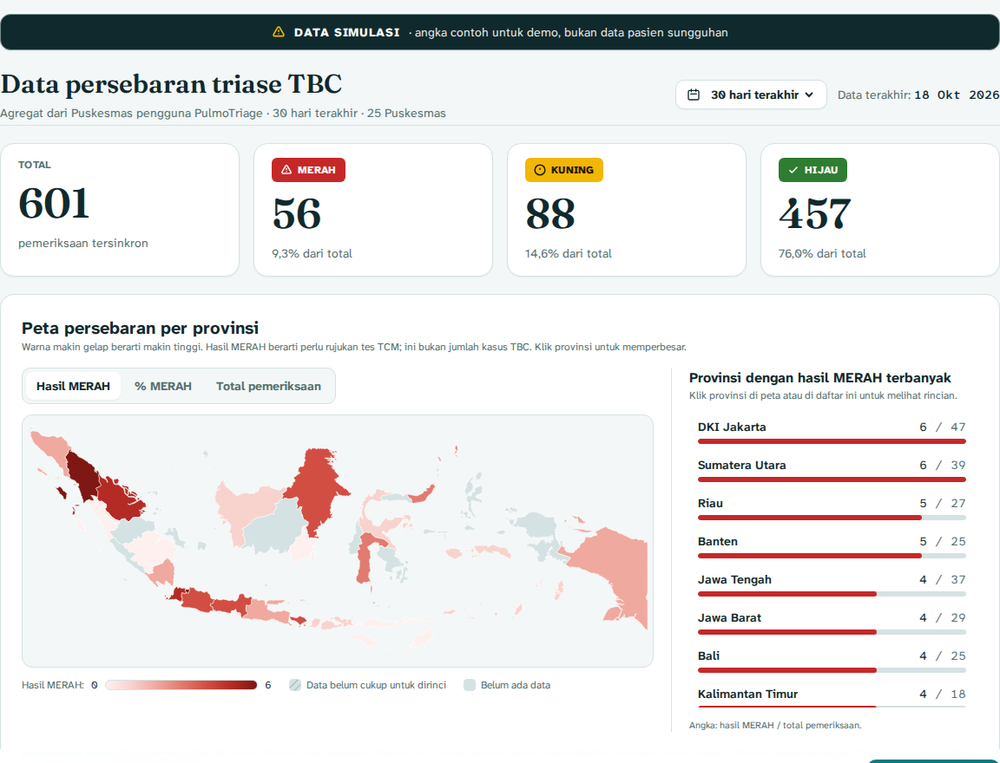
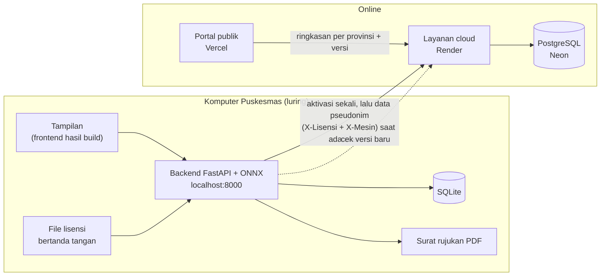

<div align="center">


<br>

**Alat bantu triase TBC untuk Puskesmas.** Unggah rontgen dada, centang gejala, dan dapatkan kategori MERAH, KUNING, atau HIJAU dengan peta panas. Semuanya berjalan di komputer Puskesmas, tanpa internet.

<br>


[Tentang](#-tentang) ·
[Tangkapan layar](#-tangkapan-layar) ·
[Cara kerja](#-cara-kerja) ·
[Arsitektur](#-arsitektur) ·
[Model AI](#-model-ai) ·
[Mulai cepat](#-mulai-cepat) ·
[API](#-api) ·
[Tim](#-tim)

</div>

> [!IMPORTANT]
> PulmoTriage adalah **alat bantu triase, bukan alat diagnosis**. Setiap hasil wajib ditinjau dokter dan dikonfirmasi dengan pemeriksaan bakteriologis (TCM). Model belum divalidasi pada pasien Indonesia. Untuk demo, gunakan data pasien fiktif saja.

<br>

## ◆ Tentang

Indonesia menanggung beban TBC tertinggi ke-2 di dunia, dengan sekitar 1,08 juta kasus baru per tahun (WHO Global TB Report 2025). Rontgen dada bisa diambil di daerah, tetapi pembacanya terbatas: sekitar satu dokter spesialis radiologi untuk 125 ribu penduduk.

PulmoTriage membantu petugas Puskesmas memilah pasien terduga TBC lebih cepat:

| | Fitur | Keterangan |
|:--:|---|---|
| 📴 | **Luring (offline-first)** | Model berjalan di komputer Puskesmas biasa (CPU, tanpa GPU). Data disinkronkan saat ada sinyal. |
| 🩻 | **Gerbang kualitas citra** | Foto buram, terputar, atau bukan rontgen ditolak dengan panduan foto ulang. |
| 🧠 | **Skor AI + peta panas** | EfficientNet-B0 dalam format ONNX, dilengkapi peta panas Grad-CAM sebagai petunjuk untuk dokter. |
| 🚦 | **Triase 3 warna** | Skor AI digabung dengan 6 gejala klinis menjadi MERAH, KUNING, atau HIJAU beserta anjuran. |
| 🩺 | **Tinjauan dokter** | Dokter menekan Setuju atau Tidak setuju. Keputusan akhir selalu di tangan dokter. |
| 📄 | **Draf surat rujukan** | PDF terisi otomatis dari data pemeriksaan, bertanda DRAFT sampai ditinjau. |
| 🔄 | **Sinkron pseudonim** | Hanya data tanpa identitas langsung yang dikirim ke server, untuk peta persebaran publik. |
| 🌏 | **Portal publik** | Situs terpisah untuk mengenal PulmoTriage dan mengunduh installer, dengan peta gradasi per provinsi (klik untuk memperbesar), tren harian, dan tabel per provinsi. Bisa dibuka siapa saja; hanya angka gabungan. |
| 🔑 | **Lisensi satu komputer** | File lisensi bertanda tangan digital. Diaktifkan online sekali, lalu terikat ke satu komputer dan diperiksa tanpa internet. |
| ⬆️ | **Pemberitahuan pembaruan** | Saat online, aplikasi memberi tahu bila ada versi baru dan menautkan installer terbaru. |

<br>

## ◆ Tangkapan layar

<table>
  <tr>
    <td width="50%"></td>
    <td width="50%"></td>
  </tr>
  <tr>
    <td align="center"><sub><b>1 · Data pasien</b></sub></td>
    <td align="center"><sub><b>2 · Unggah citra</b></sub></td>
  </tr>
  <tr>
    <td width="50%"></td>
    <td width="50%"></td>
  </tr>
  <tr>
    <td align="center"><sub><b>3 · Hasil triase</b></sub></td>
    <td align="center"><sub><b>Portal publik</b></sub></td>
  </tr>
</table>

<br>

## ◆ Cara kerja


| Kategori | Kapan muncul | Anjuran di aplikasi |
|---|---|---|
| 🔴 **MERAH** | Skor AI ≥ 0,910, atau skor menengah (0,081–0,910) pada pasien bergejala | Rujuk ke fasilitas rujukan dan lakukan pemeriksaan konfirmasi TCM |
| 🟡 **KUNING** | Skor menengah tanpa gejala, atau skor rendah (< 0,081) pada pasien bergejala | Konsultasikan dengan dokter dan periksa dahak/TCM sesuai alur program TBC |
| 🟢 **HIJAU** | Skor AI < 0,081 dan tidak bergejala | Tidak ada tindak lanjut TBC khusus; edukasi pasien untuk kembali bila gejala muncul |
| 🟡 **Periksa citra** | Citra lolos gerbang tetapi kurang mirip rontgen latih | Selalu KUNING (tidak pernah HIJAU atau MERAH); pastikan citra adalah rontgen dada PA/AP |

<sub><b>Bergejala</b> berarti ada minimal satu dari batuk lebih dari 2 minggu, kontak serumah dengan pasien TBC, atau riwayat pengobatan TBC; atau minimal dua dari demam, berat badan turun, dan keringat malam. Aturan ini tidak pernah menurunkan kategori dan masih perlu dikalibrasi bersama klinisi.</sub>

<details>
<summary><b>Contoh keluaran model (rontgen asli + peta panas)</b></summary>
<br>

</details>

<br>

## ◆ Arsitektur

PulmoTriage terdiri dari **dua aplikasi yang di-deploy terpisah**, dihubungkan oleh satu layanan cloud:

1. **Aplikasi Puskesmas** (`backend/` + `frontend/`): satu program yang dipasang di komputer Puskesmas. Berjalan tanpa internet di `http://localhost:8000`.
2. **Portal publik** (`portal/`): situs online (Vercel) untuk mengenal PulmoTriage, mengunduh installer, dan melihat peta persebaran per provinsi. Terbuka untuk Puskesmas, klinik swasta, dan masyarakat.
3. **Layanan cloud** (`cloud/`): API di Render dengan database PostgreSQL di Neon. Mengaktifkan lisensi, menerima data pseudonim dari komputer berlisensi, memberi info versi terbaru, dan menyajikan ringkasan per provinsi untuk portal.



| Bagian | Folder | Teknologi | Tempat jalan |
|---|---|---|---|
| Aplikasi Puskesmas | `backend/`, `frontend/` | FastAPI, ONNX Runtime, SQLite, ReportLab, Next.js (ekspor statis) | Komputer Puskesmas, luring |
| Layanan cloud | `cloud/` | FastAPI, SQLAlchemy, PostgreSQL | Render + Neon |
| Portal publik | `portal/` | Next.js | Vercel |
| Penerbit lisensi | `scripts/lisensi/` | Python, Ed25519 | Laptop tim PulmoTriage |

<br>

## ◆ Model AI

| | |
|---|---|
| **Arsitektur** | EfficientNet-B0 (ImageNet), seluruh lapisan dilatih ulang, input 320 × 320 |
| **Loss** | Focal loss (α = 0,75, γ = 2,0) untuk data tidak seimbang (±5 normal : 1 TBC) |
| **Data** | TB Chest X-ray Database ([Rahman dkk., 2020](https://arxiv.org/abs/2007.14895)): 4.200 citra (3.500 normal, 700 TBC) |
| **Pembagian** | 70/15/15, dibagi per sumber × kelas; foto hampir kembar dijaga di split yang sama (dHash 256-bit) |
| **Format** | ONNX (16 MB), berjalan di CPU |
| **Versi** | `pulmotriage-effb0-v3.1` |

### Hasil uji internal

Diuji pada 628 citra yang disisihkan (103 TBC). Citra ini tidak dipakai untuk melatih model atau menentukan ambang.

| Ambang | Sensitivitas | Spesifisitas |
|---|---|---|
| Rendah (0,081) | **100%** (103/103) · IK 95% 96,5–100% | **98,7%** (518/525) |
| Tinggi (0,910) | 98,1% | 100% |

Gerbang kualitas salah menolak 0,2% rontgen asli.

<br>

## ◆ Mulai cepat

### Prasyarat

| Alat | Versi | Cek dengan |
|---|---|---|
| Python | **3.11** (paket yang dipakai butuh ≥ 3.11) | `py -3.11 --version` |
| Node.js | ≥ 20.9 (hanya untuk mengembangkan tampilan dan portal) | `node -v` |
| Git | terbaru | `git --version` |

### A. Memasang di komputer Puskesmas (installer)

Unduh **`PulmoTriage-Setup.exe`** dari portal atau dari [GitHub Releases](https://github.com/K2Sandy/pulmotriage/releases/latest), lalu jalankan. Tidak perlu Python atau hak admin. Setelah terpasang, buka *PulmoTriage* dari desktop dan pasang file lisensi (aktivasi pertama butuh internet). Cara membangun installer ada di [`installer/README.md`](installer/README.md).

### A2. Menjalankan dari kode (satu klik, luring)

Klik dua kali **`jalankan-pulmotriage.bat`** di folder utama. Saat pertama kali, skrip menyiapkan Python dan paketnya (butuh internet sekali). Setelah itu aplikasi terbuka di http://localhost:8000 dan berjalan tanpa internet.

Saat pertama dibuka, aplikasi meminta **file lisensi**. Pasang file `lisensi-<ID>.json` dari tim (lihat bagian [Lisensi Puskesmas](#-lisensi-puskesmas)).

### B. Mode pengembangan

```bash
# Terminal 1: backend
cd backend
py -3.11 -m venv .venv
.venv\Scripts\activate
pip install -r requirements.txt
uvicorn main:app --reload --port 8000

# Terminal 2: layanan cloud (opsional, untuk uji sinkron)
cd cloud
py -3.11 -m venv .venv
.venv\Scripts\activate
pip install -r requirements.txt
uvicorn main:app --reload --port 8001

# Terminal 3: tampilan Puskesmas (http://localhost:3000)
cd frontend
npm install
npm run dev

# Terminal 4: portal publik (http://localhost:3001)
cd portal
npm install
npm run dev
```

Setelah mengubah tampilan Puskesmas, bangun ulang versi luring:

```bash
cd frontend
npm run build:offline     # hasilnya disalin ke backend/web
```

> [!TIP]
> Kalau PowerShell menolak menjalankan `activate`, jalankan sekali `Set-ExecutionPolicy -Scope CurrentUser -ExecutionPolicy RemoteSigned`, lalu buka ulang terminal.

### Variabel lingkungan

| Variabel | Dipakai di | Bawaan | Fungsi |
|---|---|---|---|
| `CLOUD_URL` | backend | `http://localhost:8001` (skrip .bat: alamat Render) | Alamat layanan cloud |
| `SINKRON_DETIK` | backend | `60` | Jeda sinkron otomatis. `0` mematikannya |
| `LISENSI_WAJIB` | backend | `1` | `0` = boleh dipakai tanpa lisensi (khusus pengembangan) |
| `SYNC_API_KEY` | backend, cloud | kosong / `dev-key` | Kunci cadangan untuk pengembangan dan `/demo/seed`. Puskesmas berlisensi tidak memerlukannya |
| `PUSKESMAS_ID`, `NAMA_FASILITAS` | backend | | Cadangan bila lisensi belum dipasang. Normalnya diambil dari lisensi |
| `DATABASE_URL` | cloud | `sqlite:///cloud.db` | Alamat PostgreSQL (Neon) |
| `CORS_ORIGINS` | cloud | `http://localhost:3000` | Alamat portal yang diizinkan (misalnya URL Vercel), pisahkan dengan koma |
| `VERSI_TERBARU` | cloud | `1.1.0` | Versi installer terbaru. Aplikasi yang lebih lama menampilkan pemberitahuan pembaruan |
| `URL_UNDUH` | cloud | GitHub `releases/latest/download/PulmoTriage-Setup.exe` | Tautan installer untuk portal dan pemberitahuan pembaruan |
| `CATATAN_VERSI` | cloud | kosong | Kalimat singkat isi pembaruan |
| `BATAS_PUBLIK` | cloud | `10` | Provinsi dengan pemeriksaan di bawah angka ini tidak dirinci per kategori di portal |
| `NEXT_PUBLIC_API_URL` | frontend | `http://localhost:8000` saat `npm run dev` | Alamat backend saat pengembangan |
| `NEXT_PUBLIC_CLOUD_URL` | portal | `http://localhost:8001` | Alamat layanan cloud |
| `NEXT_PUBLIC_KONTAK` | portal | kosong | Opsional: tautan permintaan lisensi (`mailto:` atau `https://wa.me/...`) |

<br>

## ◆ Lisensi Puskesmas

Setiap Puskesmas memakai **satu file lisensi** (`lisensi-<ID>.json`) yang ditandatangani digital oleh tim. Aplikasi memeriksanya memakai kunci publik `backend/lisensi_publik.pem`. File yang diubah, misalnya tanggalnya diperpanjang sendiri, otomatis ditolak.

**Satu lisensi, satu komputer.** Saat file lisensi dipasang, aplikasi menghubungi layanan cloud **sekali** (`POST /lisensi/aktivasi`) dan mengikat lisensi ke ID komputer itu (diturunkan dari MachineGuid Windows). Setelah itu aplikasi berjalan tanpa internet. File lisensi yang sama ditolak di komputer lain (409), dan data sinkron dari komputer lain juga ditolak (403). Untuk memindahkan lisensi, misalnya komputer rusak, tim menghapus aktivasinya:

```bash
curl -X DELETE https://<layanan-cloud>/lisensi/aktivasi/1171-001 -H "X-API-Key: <SYNC_API_KEY>"
```

Cara paling mudah: klik dua kali **`scripts/lisensi/penerbit-lisensi.bat`**. Tinggal pilih provinsi → kabupaten/kota → Puskesmas → masa berlaku, lalu klik *Terbitkan lisensi*. Tidak ada yang diketik, jadi kode dan nama tidak bisa salah. Daftar 10.292 Puskesmas di 514 kab/kota ada di [`scripts/lisensi/data/`](scripts/lisensi/data/README.md) (Komdat Kemenkes 2021, kab/kota Kepmendagri 2025); setiap Puskesmas sudah punya kode lisensi tetap, misalnya `1171-001` = Puskesmas Meuraxa. Bisa memilih beberapa Puskesmas sekaligus, dan klik dua kali lisensi lama untuk memperpanjangnya.

Versi baris perintah:

```bash
# Sekali saja, di laptop tim: membuat pasangan kunci
python scripts/lisensi/buat_kunci.py

# Menerbitkan lisensi untuk satu Puskesmas (kode jadi 1171-001)
python scripts/lisensi/terbitkan_lisensi.py --kode-wilayah 1171 --nomor 1 --provinsi "Aceh" --kab-kota "Kota Banda Aceh" --nama "Puskesmas Meuraxa" --sampai 2027-10-31

# Atau banyak sekaligus dari CSV
python scripts/lisensi/terbitkan_lisensi.py --csv scripts/lisensi/contoh_daftar_puskesmas.csv
```

| Status | Arti | Pemeriksaan baru |
|---|---|---|
| Aktif | Dalam masa berlaku. Peringatan mulai 30 hari sebelum berakhir | ✅ |
| Masa tenggang | Sudah berakhir, kurang dari 30 hari | ✅ (dengan peringatan) |
| Kedaluwarsa | Lewat masa tenggang | ⛔ (riwayat dan PDF tetap bisa dibuka) |
| Tidak valid | Tanda tangan tidak cocok atau format salah | ⛔ |
| Belum aktif | File ada tetapi belum diaktifkan online di komputer ini | ⛔ (pasang ulang file saat ada internet) |
| Komputer lain | File aktivasi disalin dari komputer lain | ⛔ |

Setiap Puskesmas mendapat **kode unik** `<kode wilayah kab/kota>-<nomor urut>`, misalnya `1171-001`. Kode wilayah mengikuti kode Kemendagri/BPS (2 angka provinsi + 2 angka kab/kota); provinsinya menentukan bidang di peta portal. Nama, provinsi, dan kabupaten/kota dari lisensi tampil di aplikasi dan di kop surat rujukan. Saat sinkron, aplikasi mengirim lisensi dan ID komputer (header `X-Lisensi` dan `X-Mesin`), jadi cloud hanya menerima data dari komputer yang diaktifkan, tanpa kunci API bersama.

> [!CAUTION]
> `scripts/lisensi/kunci_rahasia.pem` hanya boleh ada di laptop tim. Jangan di-commit dan jangan dikirim. File itu sudah tercantum di `.gitignore`.

<br>

## ◆ Merilis pembaruan

Pembaruan dipasang dengan menjalankan installer versi baru di atas versi lama. Data pemeriksaan dan lisensi disimpan di `%LOCALAPPDATA%\PulmoTriage\data`, terpisah dari program, jadi tidak hilang dan lisensi tidak perlu diaktifkan ulang.

| Langkah | Siapa | Apa |
|---|---|---|
| 1 | Tim | Naikkan `VERSI` di `backend/versi.py` (misalnya `1.1.0` → `1.2.0`), bangun ulang tampilan dan installer |
| 2 | Tim | Buat GitHub Release baru dan unggah installer dengan nama tetap **`PulmoTriage-Setup.exe`**. Tautan `releases/latest/download/PulmoTriage-Setup.exe` otomatis menunjuk ke versi terbaru |
| 3 | Tim | Di Render, ubah `VERSI_TERBARU` menjadi versi baru (dan `CATATAN_VERSI` bila perlu) |
| 4 | Puskesmas | Saat komputer online, muncul pemberitahuan "Versi baru PulmoTriage tersedia". Klik **Unduh pembaruan**, jalankan installer, selesai |

Komputer yang selalu luring tidak mendapat pemberitahuan; installer baru bisa dibawa dengan flashdisk dan dipasang dengan cara yang sama.

<br>

## ◆ API

<details open>
<summary><b>Backend Puskesmas · :8000</b></summary>

| Metode | Endpoint | Fungsi |
|---|---|---|
| `GET` | `/health` | Status, versi aplikasi, dan versi model |
| `POST` | `/analyze` | Analisis rontgen: `foto`, `gejala`, `nama`, `umur`, `jenis_kelamin` |
| `GET` | `/pemeriksaan` | Daftar riwayat pemeriksaan |
| `GET` | `/pemeriksaan/{id}` | Detail satu pemeriksaan |
| `POST` | `/pemeriksaan/{id}/tinjau` | Tinjauan dokter: `setuju` atau `tidak_setuju`, plus catatan |
| `GET` | `/pemeriksaan/{id}/rujukan.pdf` | Draf surat rujukan PDF |
| `GET` | `/sinkron/status` | Jumlah data yang menunggu sinkron |
| `POST` | `/sinkron` | Sinkron sekarang ke layanan cloud |
| `GET` | `/lisensi` | Status lisensi terpasang |
| `POST` | `/lisensi` | Pasang lisensi (file `berkas`) |
| `DELETE` | `/lisensi` | Lepas lisensi dari aplikasi (data tidak terhapus; aktivasi di cloud tetap) |
| `GET` | `/pembaruan` | Cek versi baru ke cloud (disimpan 1 jam; `status: offline` bila tanpa internet) |

</details>

<details>
<summary><b>Layanan cloud · :8001</b></summary>

| Metode | Endpoint | Fungsi |
|---|---|---|
| `GET` | `/health` | Status layanan |
| `GET` | `/versi` | Versi installer terbaru, tautan unduh, catatan |
| `POST` | `/lisensi/aktivasi` | Aktivasi lisensi di satu komputer (header `X-Lisensi`, body `id_mesin`) |
| `GET` | `/lisensi/aktivasi` | Daftar aktivasi (header `X-API-Key`) |
| `DELETE` | `/lisensi/aktivasi/{puskesmas_id}` | Lepas aktivasi agar lisensi bisa dipindah (header `X-API-Key`) |
| `POST` | `/sync` | Terima data pseudonim dari komputer yang diaktifkan (header `X-Lisensi` + `X-Mesin`, atau `X-API-Key` untuk pengembangan) |
| `GET` | `/publik/ringkasan?hari=30` | Ringkasan per provinsi untuk portal (terbuka, tanpa data per Puskesmas) |
| `GET` | `/dashboard/ringkasan?hari=30` | Ringkasan internal per Puskesmas (header `X-API-Key`) |
| `POST` | `/demo/seed` | Isi data simulasi (header `X-API-Key`) |
| `DELETE` | `/demo` | Hapus data simulasi (header `X-API-Key`) |

</details>

<details>
<summary><b>Contoh respons <code>/analyze</code></b></summary>

```json
{
  "status": "ok",
  "prob_tb": 0.9997,
  "triage": {
    "category": "MERAH",
    "title": "Rujuk segera",
    "action": "Rujuk ke fasilitas rujukan dan lakukan pemeriksaan konfirmasi TCM ...",
    "ai_level": "HIGH",
    "atypical": false,
    "reasons": ["..."]
  },
  "warnings": [],
  "heatmap_png": "<base64>",
  "heatmap_strength": 1.0,
  "model_version": "pulmotriage-effb0-v3.1",
  "disclaimer": "Hasil ini adalah alat bantu triase, bukan diagnosis. ...",
  "id": 1
}
```

Foto yang ditolak gerbang kualitas mengembalikan `"status": "rejected"` dengan alasan di `quality.issues`. Itu bukan error.

</details>

<br>

## ◆ Privasi data

| ✅ Dikirim ke server cloud | ⛔ Tidak pernah keluar dari Puskesmas |
|---|---|
| Kode acak (`uid`) | Nama pasien |
| Tanggal pemeriksaan (tanpa jam) | Umur pasti |
| Kelompok umur dan jenis kelamin | Foto rontgen |
| Gejala yang dicentang | Peta panas |
| Tingkat AI, kategori, penanda citra janggal, versi model | Keputusan dan catatan dokter |

Sistem dirancang mengikuti prinsip minimisasi data UU PDP No. 27 Tahun 2022. Data yang dikirim adalah data pseudonim, bukan anonim penuh.

<br>

## ◆ Struktur folder

```text
PulmoTriage/
├── jalankan-pulmotriage.bat  menjalankan aplikasi Puskesmas (satu klik)
├── backend/                  aplikasi Puskesmas: API + model, luring
│   ├── main.py               endpoint API + menyajikan tampilan dari web/
│   ├── pulmotriage_infer.py  gerbang kualitas, inferensi, triase, peta panas
│   ├── pulmotriage.onnx      model (16 MB)
│   ├── lisensi.py            pemeriksaan lisensi (luring)
│   ├── lisensi_publik.pem    kunci publik lisensi
│   ├── db.py · pdf.py · sinkron.py · pembaruan.py
│   ├── versi.py              nomor versi aplikasi (naikkan saat rilis)
│   ├── assets/               font dan logo untuk surat rujukan
│   └── web/                  tampilan hasil `npm run build:offline`
├── frontend/                 kode tampilan aplikasi Puskesmas (Next.js)
├── portal/                   portal publik + unduhan installer (Next.js, Vercel)
├── cloud/                    aktivasi lisensi, sinkron, versi, API portal (Render + Neon)
├── scripts/lisensi/          pembuat kunci, penerbit lisensi (pilih dari daftar + baris perintah), laptop tim
│   └── data/                 daftar Puskesmas dan kab/kota untuk penerbit lisensi
├── installer/                pembuat installer Windows (NSIS + Python embeddable)
├── docs/
│   ├── assets/               gambar README
│   └── panduan-demo.md       alur dan naskah video demo
├── LICENSE
└── README.md
```

<br>

## ◆ Peta jalan

- [x] Model v3.1 + gerbang kualitas + peta panas
- [x] Backend: analisis, riwayat, tinjauan dokter, draf PDF, sinkron
- [x] Layanan cloud + API portal
- [x] Antarmuka Next.js sesuai DESIGN.md
- [x] Aplikasi Puskesmas sebagai satu program luring
- [x] Lisensi per Puskesmas (tanda tangan digital, diperiksa luring)
- [x] Portal publik terpisah (Vercel) + layanan cloud (Render + Neon)
- [x] Lisensi satu komputer (aktivasi online sekali)
- [x] Pemberitahuan pembaruan di aplikasi
- [ ] Dasbor internal dengan login untuk Dinas Kesehatan
- [x] Installer Windows untuk Puskesmas (tanpa admin, data terpisah dari program)
- [ ] Tanda tangan kode (code signing) untuk installer
- [ ] Uji eksternal pada dataset lain
- [ ] Pilot 3–8 Puskesmas rawat inap di Aceh, dengan TCM sebagai acuan
- [ ] Kalibrasi ulang ambang dengan data lokal

<br>

## ◆ Tim

<table>
  <tr>
    <td align="center" width="33%"><br><b>Muhammad Albharaka Putrosandy</b><br><sub>AI Research & Lead Developer</sub></td>
    <td align="center" width="33%"><br><b>Ibnul Jawzy</b><br><sub>Software & Infrastructure Engineer</sub></td>
    <td align="center" width="33%"><br><b>Muhammad Rizki</b><br><sub>UI/UX & Clinical Workflow</sub></td>
  </tr>
</table>

<div align="center"><sub><b>Tim Sleber</b> · Informatika FMIPA, Universitas Syiah Kuala · INFEST XII Hackathon 2026</sub></div>

<br>

## ◆ Referensi

- Rahman, T. dkk. (2020). *Reliable Tuberculosis Detection using Chest X-ray with Deep Learning, Segmentation and Visualization.* IEEE Access. [arXiv:2007.14895](https://arxiv.org/abs/2007.14895)
- Tan, M. & Le, Q. (2019). *EfficientNet: Rethinking Model Scaling for Convolutional Neural Networks.* ICML.
- Lin, T.-Y. dkk. (2017). *Focal Loss for Dense Object Detection.* ICCV.
- Selvaraju, R. R. dkk. (2017). *Grad-CAM: Visual Explanations from Deep Networks via Gradient-based Localization.* ICCV.
- World Health Organization (2021). *Consolidated guidelines on tuberculosis, Module 2: Screening.*
- World Health Organization (2025). *Global Tuberculosis Report 2025.*

<br>

## ◆ Lisensi

Kode dirilis di bawah [lisensi MIT](LICENSE). Dataset pelatihan mengikuti lisensi dari penyedianya masing-masing. Font Fraunces dan Atkinson Hyperlegible berlisensi SIL Open Font License.

<div align="center">
<br>

</div>
