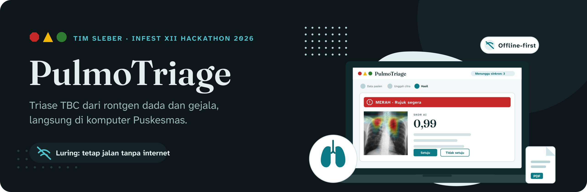
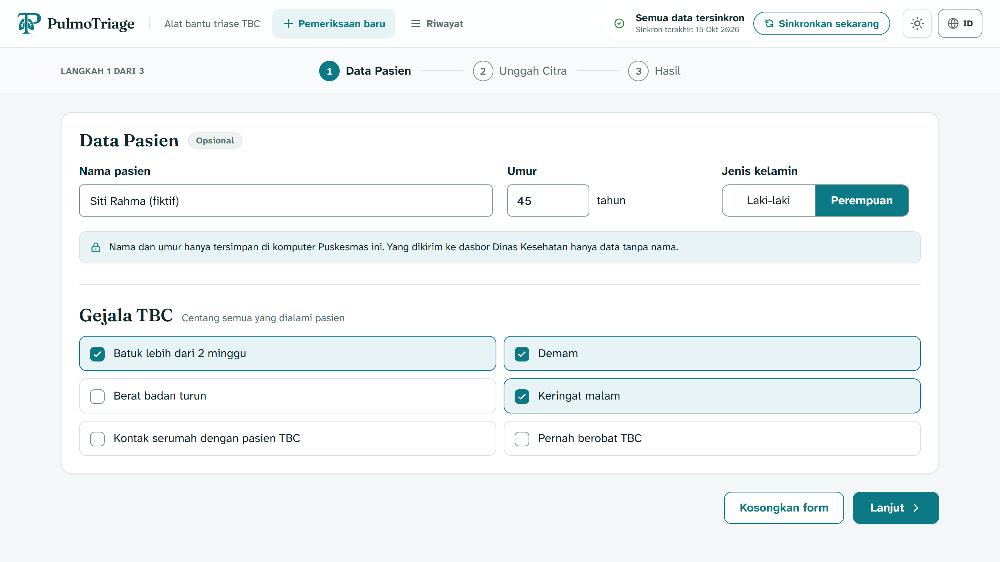
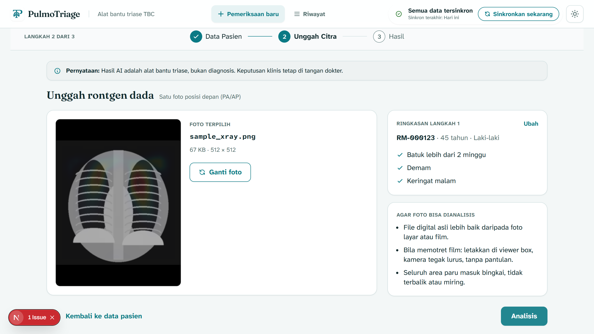
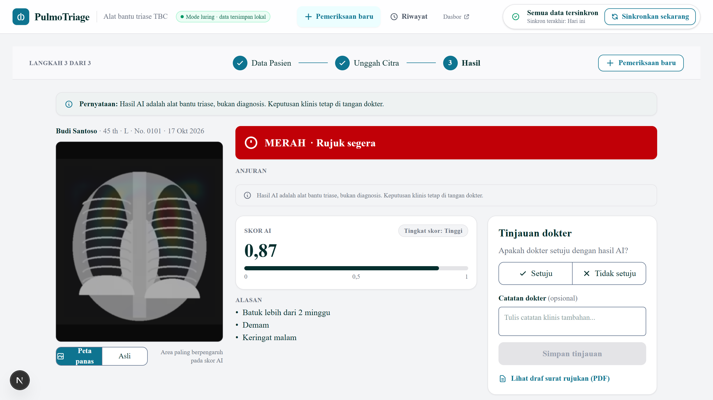
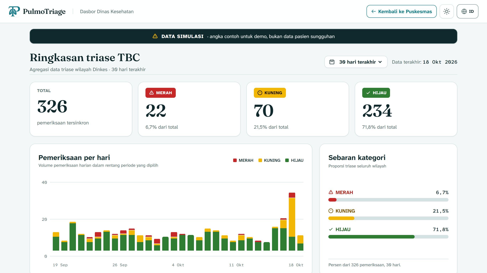
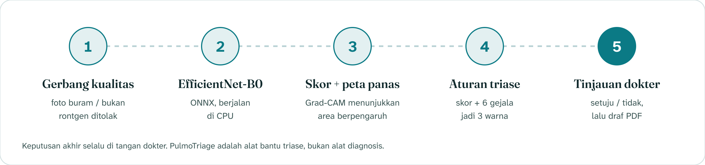
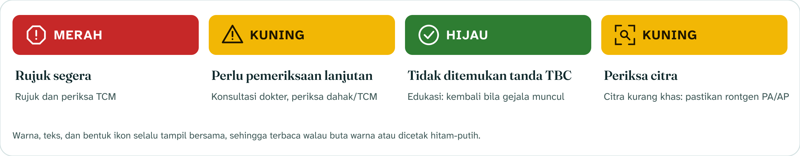
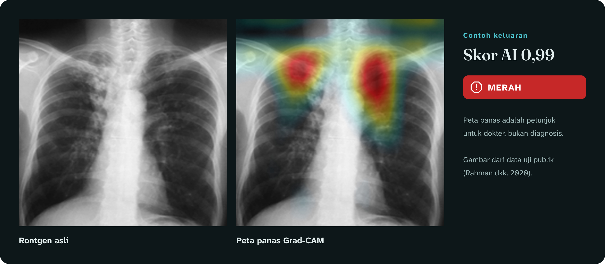
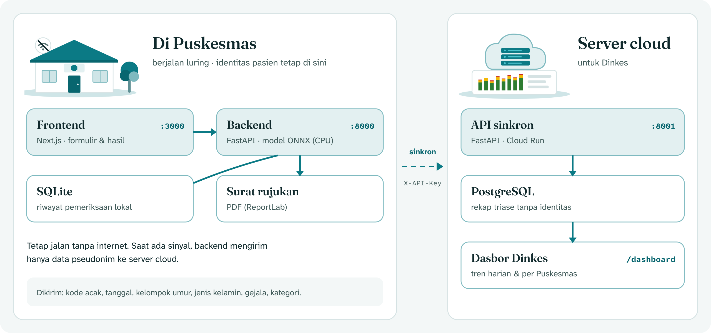
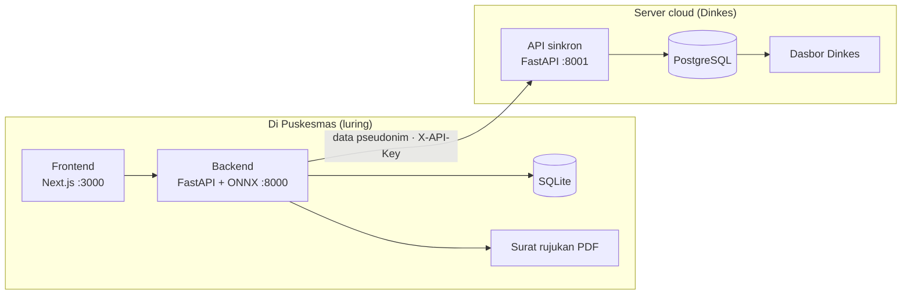

<div align="center">



<br>

**Alat bantu triase TBC untuk Puskesmas.** Unggah rontgen dada, centang gejala, dan dapatkan kategori MERAH, KUNING, atau HIJAU dengan peta panas. Semuanya berjalan di komputer Puskesmas, tanpa internet.

<br>


[Tentang](#-tentang) ·
[Tangkapan layar](#-tangkapan-layar) ·
[Cara kerja](#-cara-kerja) ·
[Arsitektur](#-arsitektur) ·
[Model AI](#-model-ai) ·
[Mulai cepat](#-mulai-cepat) ·
[API](#-api) ·
[Tim](#-tim)

</div>

> [!IMPORTANT]
> PulmoTriage adalah **alat bantu triase, bukan alat diagnosis**. Setiap hasil wajib ditinjau dokter dan dikonfirmasi dengan pemeriksaan bakteriologis (TCM). Model belum divalidasi pada pasien Indonesia. Untuk demo, gunakan data pasien fiktif saja.

<br>

## ◆ Tentang

Indonesia menanggung beban TBC tertinggi ke-2 di dunia, dengan sekitar 1,08 juta kasus baru per tahun (WHO Global TB Report 2025). Rontgen dada bisa diambil di daerah, tetapi pembacanya terbatas: sekitar satu dokter spesialis radiologi untuk 125 ribu penduduk.

PulmoTriage membantu petugas Puskesmas memilah pasien terduga TBC lebih cepat:

| | Fitur | Keterangan |
|:--:|---|---|
| 📴 | **Luring (offline-first)** | Model berjalan di komputer Puskesmas biasa (CPU, tanpa GPU). Data disinkronkan saat ada sinyal. |
| 🩻 | **Gerbang kualitas citra** | Foto buram, terputar, atau bukan rontgen ditolak dengan panduan foto ulang. |
| 🧠 | **Skor AI + peta panas** | EfficientNet-B0 dalam format ONNX, dilengkapi peta panas Grad-CAM sebagai petunjuk untuk dokter. |
| 🚦 | **Triase 3 warna** | Skor AI digabung dengan 6 gejala klinis menjadi MERAH, KUNING, atau HIJAU beserta anjuran. |
| 🩺 | **Tinjauan dokter** | Dokter menekan Setuju atau Tidak setuju. Keputusan akhir selalu di tangan dokter. |
| 📄 | **Draf surat rujukan** | PDF terisi otomatis dari data pemeriksaan, bertanda DRAFT sampai ditinjau. |
| 🔄 | **Sinkron pseudonim** | Hanya data tanpa identitas langsung yang dikirim ke server untuk dasbor Dinkes. |
| 📊 | **Dasbor Dinkes** | Tren MERAH, KUNING, HIJAU per hari dan per Puskesmas. |

<br>

## ◆ Tangkapan layar

<table>
  <tr>
    <td width="50%"></td>
    <td width="50%"></td>
  </tr>
  <tr>
    <td align="center"><sub><b>1 · Data pasien</b></sub></td>
    <td align="center"><sub><b>2 · Unggah citra</b></sub></td>
  </tr>
  <tr>
    <td width="50%"></td>
    <td width="50%"></td>
  </tr>
  <tr>
    <td align="center"><sub><b>3 · Hasil triase</b></sub></td>
    <td align="center"><sub><b>Dasbor Dinkes</b></sub></td>
  </tr>
</table>
  <tr>
    <td align="center"><sub><b>3 · Hasil triase</b></sub></td>
    <td align="center"><sub><b>Dasbor Dinkes</b></sub></td>
  </tr>
</table>

<br>

## ◆ Cara kerja





| Kategori | Kapan muncul | Anjuran di aplikasi |
|---|---|---|
| 🔴 **MERAH** | Skor AI ≥ 0,910, atau skor menengah (0,081–0,910) pada pasien bergejala | Rujuk ke fasilitas rujukan dan lakukan pemeriksaan konfirmasi TCM |
| 🟡 **KUNING** | Skor menengah tanpa gejala, atau skor rendah (< 0,081) pada pasien bergejala | Konsultasikan dengan dokter dan periksa dahak/TCM sesuai alur program TBC |
| 🟢 **HIJAU** | Skor AI < 0,081 dan tidak bergejala | Tidak ada tindak lanjut TBC khusus; edukasi pasien untuk kembali bila gejala muncul |
| 🟡 **Periksa citra** | Citra lolos gerbang tetapi kurang mirip rontgen latih | Selalu KUNING (tidak pernah HIJAU atau MERAH); pastikan citra adalah rontgen dada PA/AP |

<sub><b>Bergejala</b> berarti ada minimal satu dari batuk lebih dari 2 minggu, kontak serumah dengan pasien TBC, atau riwayat pengobatan TBC; atau minimal dua dari demam, berat badan turun, dan keringat malam. Aturan ini tidak pernah menurunkan kategori dan masih perlu dikalibrasi bersama klinisi.</sub>

<details>
<summary><b>Contoh keluaran model (rontgen asli + peta panas)</b></summary>
<br>

</details>

<br>

## ◆ Arsitektur



<details>
<summary><b>Versi Mermaid (bisa diedit)</b></summary>



</details>

| Bagian | Teknologi | Tempat deploy |
|---|---|---|
| Frontend | Next.js 16, React, Tailwind CSS | Vercel |
| Backend Puskesmas | Python 3.11, FastAPI, ONNX Runtime, SQLite, ReportLab | Komputer Puskesmas / Google Cloud Run (demo) |
| Layanan cloud | FastAPI, SQLAlchemy, PostgreSQL | Google Cloud Run + Neon/Supabase atau Cloud SQL |

<br>

## ◆ Model AI

| | |
|---|---|
| **Arsitektur** | EfficientNet-B0 (ImageNet), seluruh lapisan dilatih ulang, input 320 × 320 |
| **Loss** | Focal loss (α = 0,75, γ = 2,0) untuk data tidak seimbang (±5 normal : 1 TBC) |
| **Data** | TB Chest X-ray Database ([Rahman dkk., 2020](https://arxiv.org/abs/2007.14895)): 4.200 citra (3.500 normal, 700 TBC) |
| **Pembagian** | 70/15/15, dibagi per sumber × kelas; foto hampir kembar dijaga di split yang sama (dHash 256-bit) |
| **Format** | ONNX (16 MB), berjalan di CPU |
| **Versi** | `pulmotriage-effb0-v3.1` |

### Hasil uji internal

Diuji pada 628 citra yang disisihkan (103 TBC). Citra ini tidak dipakai untuk melatih model atau menentukan ambang.

| Ambang | Sensitivitas | Spesifisitas |
|---|---|---|
| Rendah (0,081) | **100%** (103/103) · IK 95% 96,5–100% | **98,7%** (518/525) |
| Tinggi (0,910) | 98,1% | 100% |

Gerbang kualitas salah menolak 0,2% rontgen asli.

<br>

## ◆ Mulai cepat

### Prasyarat

| Alat | Versi | Cek dengan |
|---|---|---|
| Python | **3.11** (paket yang dipakai butuh ≥ 3.11) | `py -3.11 --version` |
| Node.js | ≥ 20.9 (untuk frontend) | `node -v` |
| Git | terbaru | `git --version` |

### 1. Backend Puskesmas (port 8000)

```bash
cd backend
py -3.11 -m venv .venv          # macOS/Linux: python3.11 -m venv .venv
.venv\Scripts\activate          # macOS/Linux: source .venv/bin/activate
pip install -r requirements.txt
uvicorn main:app --reload --port 8000
```

Buka http://localhost:8000/health. Hasil yang benar:

```json
{"status": "ok", "model_version": "pulmotriage-effb0-v3.1"}
```

Dokumentasi API interaktif tersedia di http://localhost:8000/docs.

> [!TIP]
> Kalau PowerShell menolak menjalankan `activate`, jalankan sekali `Set-ExecutionPolicy -Scope CurrentUser -ExecutionPolicy RemoteSigned`, lalu buka ulang terminal.

### 2. Layanan cloud (port 8001)

Buka terminal baru:

```bash
cd cloud
py -3.11 -m venv .venv
.venv\Scripts\activate
pip install -r requirements.txt
uvicorn main:app --reload --port 8001
```

Tanpa `DATABASE_URL`, layanan memakai SQLite lokal (`cloud.db`), cukup untuk belajar dan uji.

### 3. Frontend (port 3000)

```bash
cd frontend
npm install
npm run dev
```

Buka http://localhost:3000.

### Variabel lingkungan

| Variabel | Dipakai di | Bawaan | Fungsi |
|---|---|---|---|
| `SINKRON_DETIK` | backend | `60` | Jeda sinkron otomatis. `0` mematikannya. |
| `CLOUD_URL` | backend | `http://localhost:8001` | Alamat layanan cloud. |
| `SYNC_API_KEY` | backend, cloud | `dev-key` | Kunci bersama untuk `/sync`. **Ganti saat deploy.** |
| `PUSKESMAS_ID` | backend | `PKM-DEMO-LOKAL` | Identitas Puskesmas pengirim. |
| `NAMA_FASILITAS` | backend | `Puskesmas (isi nama Puskesmas)` | Nama di kop surat rujukan. |
| `DATABASE_URL` | cloud | `sqlite:///cloud.db` | Alamat PostgreSQL saat deploy. |
| `CORS_ORIGINS` | cloud | `http://localhost:3000` | Alamat frontend yang diizinkan (pisahkan dengan koma). |
| `NEXT_PUBLIC_API_URL` | frontend | `http://localhost:8000` | Alamat backend. |

<br>

## ◆ API

<details open>
<summary><b>Backend Puskesmas · :8000</b></summary>

| Metode | Endpoint | Fungsi |
|---|---|---|
| `GET` | `/health` | Status dan versi model |
| `POST` | `/analyze` | Analisis rontgen: `foto`, `gejala`, `nama`, `umur`, `jenis_kelamin` |
| `GET` | `/pemeriksaan` | Daftar riwayat pemeriksaan |
| `GET` | `/pemeriksaan/{id}` | Detail satu pemeriksaan |
| `POST` | `/pemeriksaan/{id}/tinjau` | Tinjauan dokter: `setuju` atau `tidak_setuju`, plus catatan |
| `GET` | `/pemeriksaan/{id}/rujukan.pdf` | Draf surat rujukan PDF |
| `GET` | `/sinkron/status` | Jumlah data yang menunggu sinkron |
| `POST` | `/sinkron` | Sinkron sekarang ke layanan cloud |

</details>

<details>
<summary><b>Layanan cloud · :8001</b></summary>

| Metode | Endpoint | Fungsi |
|---|---|---|
| `GET` | `/health` | Status layanan |
| `POST` | `/sync` | Terima data pseudonim dari Puskesmas (header `X-API-Key`) |
| `GET` | `/dashboard/ringkasan?hari=30` | Ringkasan untuk dasbor |
| `POST` | `/demo/seed` | Isi data simulasi (header `X-API-Key`) |
| `DELETE` | `/demo` | Hapus data simulasi (header `X-API-Key`) |

</details>

<details>
<summary><b>Contoh respons <code>/analyze</code></b></summary>

```json
{
  "status": "ok",
  "prob_tb": 0.9997,
  "triage": {
    "category": "MERAH",
    "title": "Rujuk segera",
    "action": "Rujuk ke fasilitas rujukan dan lakukan pemeriksaan konfirmasi TCM ...",
    "ai_level": "HIGH",
    "atypical": false,
    "reasons": ["..."]
  },
  "warnings": [],
  "heatmap_png": "<base64>",
  "heatmap_strength": 1.0,
  "model_version": "pulmotriage-effb0-v3.1",
  "disclaimer": "Hasil ini adalah alat bantu triase, bukan diagnosis. ...",
  "id": 1
}
```

Foto yang ditolak gerbang kualitas mengembalikan `"status": "rejected"` dengan alasan di `quality.issues`. Itu bukan error.

</details>

<br>

## ◆ Privasi data

| ✅ Dikirim ke server cloud | ⛔ Tidak pernah keluar dari Puskesmas |
|---|---|
| Kode acak (`uid`) | Nama pasien |
| Tanggal pemeriksaan (tanpa jam) | Umur pasti |
| Kelompok umur dan jenis kelamin | Foto rontgen |
| Gejala yang dicentang | Peta panas |
| Tingkat AI, kategori, penanda citra janggal, versi model | Keputusan dan catatan dokter |

Sistem dirancang mengikuti prinsip minimisasi data UU PDP No. 27 Tahun 2022. Data yang dikirim adalah data pseudonim, bukan anonim penuh.

<br>

## ◆ Struktur folder

```text
PulmoTriage/
├── backend/                  FastAPI + model, berjalan di Puskesmas
│   ├── main.py               endpoint API
│   ├── pulmotriage_infer.py  gerbang kualitas, inferensi, triase, peta panas
│   ├── pulmotriage.onnx      model (16 MB)
│   ├── pulmotriage_config.json
│   ├── db.py                 penyimpanan SQLite
│   ├── pdf.py                draf surat rujukan
│   ├── sinkron.py            kirim data pseudonim ke cloud
│   └── requirements.txt
├── cloud/                    penerima sinkron + API dasbor
│   ├── main.py
│   └── requirements.txt
├── frontend/                 Next.js (formulir, hasil, dasbor)
├── docs/
│   ├── assets/               gambar README
│   └── hasil-uji.md          catatan hasil pengujian
├── LICENSE
└── README.md
```

<br>

## ◆ Peta jalan

- [x] Model v3.1 + gerbang kualitas + peta panas
- [x] Backend: analisis, riwayat, tinjauan dokter, draf PDF, sinkron
- [x] Layanan cloud + API dasbor
- [ ] Antarmuka Next.js sesuai DESIGN.md
- [ ] Deploy publik (Vercel + Cloud Run)
- [ ] Uji eksternal pada dataset lain
- [ ] Pilot 3–8 Puskesmas rawat inap di Aceh, dengan TCM sebagai acuan
- [ ] Kalibrasi ulang ambang dengan data lokal

<br>

## ◆ Tim

<table>
  <tr>
    <td align="center" width="33%"><br><b>Muhammad Albharaka Putrosandy</b><br><sub>AI Research & Lead Developer</sub></td>
    <td align="center" width="33%"><br><b>Ibnul Jawzy</b><br><sub>Software & Infrastructure Engineer</sub></td>
    <td align="center" width="33%"><br><b>Muhammad Rizki</b><br><sub>UI/UX & Clinical Workflow</sub></td>
  </tr>
</table>

<div align="center"><sub><b>Tim Sleber</b> · Informatika FMIPA, Universitas Syiah Kuala · INFEST XII Hackathon 2026</sub></div>

<br>

## ◆ Referensi

- Rahman, T. dkk. (2020). *Reliable Tuberculosis Detection using Chest X-ray with Deep Learning, Segmentation and Visualization.* IEEE Access. [arXiv:2007.14895](https://arxiv.org/abs/2007.14895)
- Tan, M. & Le, Q. (2019). *EfficientNet: Rethinking Model Scaling for Convolutional Neural Networks.* ICML.
- Lin, T.-Y. dkk. (2017). *Focal Loss for Dense Object Detection.* ICCV.
- Selvaraju, R. R. dkk. (2017). *Grad-CAM: Visual Explanations from Deep Networks via Gradient-based Localization.* ICCV.
- World Health Organization (2021). *Consolidated guidelines on tuberculosis, Module 2: Screening.*
- World Health Organization (2025). *Global Tuberculosis Report 2025.*

<br>

## ◆ Lisensi

Kode dirilis di bawah [lisensi MIT](LICENSE). Dataset pelatihan mengikuti lisensi dari penyedianya masing-masing. Font Fraunces dan Atkinson Hyperlegible berlisensi SIL Open Font License.

<div align="center">
<br>

</div>
