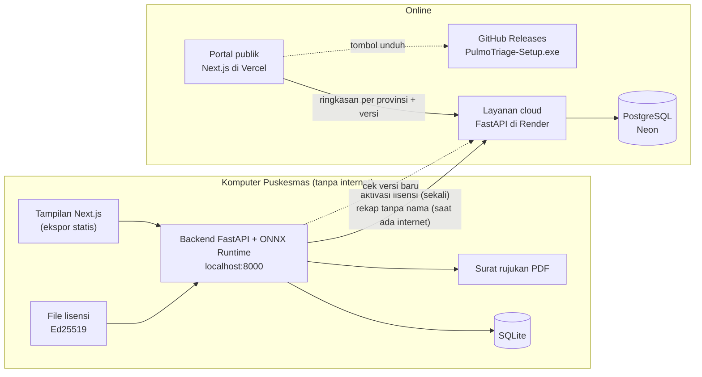

# Tech Stack PulmoTriage

Versi aplikasi: 1.1.0 · Model: `pulmotriage-effb0-v3.1` · Diperbarui: 18 Oktober 2026

PulmoTriage terdiri dari lima bagian: aplikasi Puskesmas yang berjalan tanpa internet, installer Windows, layanan cloud, portal publik, dan alat tim untuk menerbitkan lisensi. Data pasien tidak pernah keluar dari komputer Puskesmas; yang dikirim ke cloud hanya rekap tanpa nama.

---

## Daftar isi

1. [Gambaran arsitektur](#1-gambaran-arsitektur)
2. [Aplikasi Puskesmas](#2-aplikasi-puskesmas)
3. [Model AI](#3-model-ai)
4. [Installer Windows dan pembaruan](#4-installer-windows-dan-pembaruan)
5. [Layanan cloud](#5-layanan-cloud)
6. [Portal publik](#6-portal-publik)
7. [Lisensi](#7-lisensi)
8. [Alat tim: penerbit lisensi](#8-alat-tim-penerbit-lisensi)
9. [Privasi data](#9-privasi-data)
10. [Variabel lingkungan](#10-variabel-lingkungan)
11. [Struktur folder](#11-struktur-folder)
12. [Alasan pemilihan teknologi](#12-alasan-pemilihan-teknologi)
13. [Batasan yang kami sadari](#13-batasan-yang-kami-sadari)

---

## 1. Gambaran arsitektur



| Bagian | Folder | Teknologi utama | Tempat jalan |
|---|---|---|---|
| Aplikasi Puskesmas | `backend/`, `frontend/` | FastAPI, ONNX Runtime, SQLite, ReportLab, Next.js | Komputer Puskesmas, tanpa internet |
| Installer | `installer/` | NSIS, Python 3.11 embeddable | Dibangun di Linux/WSL, dipasang di Windows |
| Layanan cloud | `cloud/` | FastAPI, SQLAlchemy, PostgreSQL | Render + Neon |
| Portal publik | `portal/` | Next.js, SVG peta Natural Earth | Vercel |
| Penerbit lisensi | `scripts/lisensi/` | Python, Tkinter, Ed25519 | Laptop tim |

---

## 2. Aplikasi Puskesmas

Satu program yang dipasang di komputer Puskesmas. Backend menyajikan API sekaligus tampilan di `http://localhost:8000`, jadi tidak ada server terpisah dan tidak butuh internet.

### 2.1 Backend

| Komponen | Versi | Fungsi |
|---|---|---|
| Python | 3.11 | Bahasa utama |
| FastAPI | 0.143.2 | API dan penyaji tampilan statis |
| Uvicorn | 0.54.0 | Server ASGI |
| ONNX Runtime | 1.31.0 | Menjalankan model AI di CPU |
| NumPy | 2.4.6 | Olah data gambar |
| Pillow | 12.3.0 | Baca dan olah rontgen |
| ReportLab | 5.0.1 | Membuat surat rujukan PDF |
| cryptography | 46.0.7 | Memeriksa tanda tangan lisensi Ed25519 |
| httpx | 0.28.1 | Sinkron, aktivasi, dan cek versi ke cloud |
| python-multipart | 0.0.32 | Unggah file rontgen dan lisensi |
| SQLite | bawaan Python | Menyimpan pemeriksaan di komputer |

File penting:

| File | Isi |
|---|---|
| `main.py` | Endpoint API, pembatasan pemeriksaan bila lisensi tidak aktif, penyaji tampilan dari `web/` |
| `pulmotriage_infer.py` | Gerbang kualitas, inferensi ONNX, Grad-CAM, aturan triase |
| `lisensi.py` | Pemeriksaan lisensi, ID komputer, aktivasi online |
| `sinkron.py` | Sinkron rekap tanpa nama ke cloud tiap 60 detik |
| `pembaruan.py` | Cek versi baru ke cloud (disimpan 1 jam) |
| `versi.py` | Nomor versi aplikasi |
| `db.py` · `pdf.py` | SQLite dan pembuat surat rujukan |

### 2.2 Tampilan

| Komponen | Versi | Catatan |
|---|---|---|
| Next.js | 16.4.1 | Ekspor statis (`output: "export"`), hasilnya disalin ke `backend/web` |
| React | 19.3.0 | |
| Tailwind CSS | 4 | |
| Font | Atkinson Hyperlegible Next, Fraunces | Dipaketkan bersama aplikasi, tidak mengambil dari internet |

Halaman: Pemeriksaan baru (data pasien → unggah citra → hasil), Riwayat, Aktivasi lisensi. Ada pemberitahuan versi baru yang muncul saat komputer online.

### 2.3 Endpoint backend (`localhost:8000`)

| Metode | Endpoint | Fungsi |
|---|---|---|
| `GET` | `/health` | Status, versi aplikasi, versi model |
| `POST` | `/analyze` | Analisis rontgen: `foto`, `gejala`, `nama`, `umur`, `jenis_kelamin` |
| `GET` | `/pemeriksaan` | Daftar riwayat |
| `GET` | `/pemeriksaan/{id}` | Detail satu pemeriksaan |
| `POST` | `/pemeriksaan/{id}/tinjau` | Tinjauan dokter: setuju atau tidak setuju, plus catatan |
| `GET` | `/pemeriksaan/{id}/rujukan.pdf` | Draf surat rujukan |
| `GET` | `/sinkron/status` | Jumlah data yang menunggu sinkron |
| `POST` | `/sinkron` | Sinkron sekarang |
| `GET` · `POST` · `DELETE` | `/lisensi` | Status, pasang, lepas lisensi |
| `GET` | `/pembaruan` | Cek versi baru |

---

## 3. Model AI

### 3.1 Spesifikasi

| | |
|---|---|
| Arsitektur | EfficientNet-B0 (bobot awal ImageNet), seluruh lapisan dilatih ulang |
| Input | 320 × 320 |
| Loss | Focal loss (α = 0,75, γ = 2,0) untuk data tidak seimbang (sekitar 5 normal : 1 TBC) |
| Data | TB Chest X-ray Database (Rahman dkk., 2020): 4.200 citra (3.500 normal, 700 TBC) |
| Pembagian data | 70/15/15, dibagi per sumber × kelas; foto hampir kembar dijaga di split yang sama (dHash 256-bit) |
| Format | ONNX, 16 MB, berjalan di CPU tanpa GPU |
| Penjelasan visual | Grad-CAM (peta panas), sebagai petunjuk untuk dokter, bukan batas lesi |
| Versi | `pulmotriage-effb0-v3.1` |

### 3.2 Alur satu pemeriksaan

```
Foto rontgen
  → Gerbang kualitas   (tolak foto buram, terputar, atau bukan rontgen)
  → EfficientNet-B0    (skor AI 0–1)
  → Grad-CAM           (peta panas)
  → Aturan triase      (skor AI + 6 gejala)
  → MERAH / KUNING / HIJAU + anjuran
  → Tinjauan dokter    (keputusan akhir)
```

### 3.3 Aturan triase

| Kategori | Kapan muncul | Anjuran |
|---|---|---|
| MERAH | Skor ≥ 0,910, atau skor 0,081–0,910 pada pasien bergejala | Rujuk dan lakukan tes konfirmasi TCM |
| KUNING | Skor 0,081–0,910 tanpa gejala, atau skor < 0,081 pada pasien bergejala | Konsultasi dokter, periksa dahak/TCM sesuai alur program TBC |
| HIJAU | Skor < 0,081 dan tidak bergejala | Tidak ada tindak lanjut TBC khusus; edukasi pasien |
| Periksa citra | Citra lolos gerbang tetapi kurang mirip rontgen latih | Selalu KUNING |

Bergejala berarti ada minimal satu dari batuk lebih dari 2 minggu, kontak serumah dengan pasien TBC, atau riwayat pengobatan TBC; atau minimal dua dari demam, berat badan turun, dan keringat malam. Aturan ini tidak pernah menurunkan kategori.

### 3.4 Hasil uji internal

Diuji pada 628 citra yang disisihkan (103 TBC), tidak dipakai untuk melatih atau menentukan ambang.

| Ambang | Sensitivitas | Spesifisitas |
|---|---|---|
| Rendah (0,081) | 100% (103/103), IK 95% 96,5–100% | 98,7% (518/525) |
| Tinggi (0,910) | 98,1% | 100% |

Gerbang kualitas salah menolak 0,2% rontgen asli. Ini uji internal pada dataset publik, bukan uji lapangan pada pasien Indonesia.

---

## 4. Installer Windows dan pembaruan

### 4.1 Installer

| | |
|---|---|
| Pembuat | NSIS (`makensis`), dijalankan di Linux atau WSL lewat `installer/build_installer.sh` |
| Isi | Python 3.11.9 embeddable, semua paket Python versi Windows, runtime MSVC, model, tampilan |
| Ukuran | sekitar 55 MB |
| Lokasi program | `%LOCALAPPDATA%\Programs\PulmoTriage` (tanpa hak admin) |
| Lokasi data | `%LOCALAPPDATA%\PulmoTriage\data` (`pulmotriage.db`, `lisensi.json`, `aktivasi.json`) |
| Peluncur | `launcher.py`: mengatur lokasi data dan alamat cloud, lalu menjalankan Uvicorn di `127.0.0.1:8000` dan membuka browser |
| Distribusi | GitHub Releases dengan nama file tetap `PulmoTriage-Setup.exe` |

Menghapus aplikasi tidak menghapus data pemeriksaan dan lisensi.

### 4.2 Alur pembaruan

| Langkah | Siapa | Apa |
|---|---|---|
| 1 | Tim | Naikkan `VERSI` di `backend/versi.py`, bangun ulang tampilan dan installer |
| 2 | Tim | Unggah `PulmoTriage-Setup.exe` ke GitHub Release baru |
| 3 | Tim | Ubah `VERSI_TERBARU` di Render |
| 4 | Puskesmas | Saat online, aplikasi menampilkan "Versi baru tersedia" → unduh → pasang di atas versi lama |

Tautan unduh selalu `https://github.com/K2Sandy/pulmotriage/releases/latest/download/PulmoTriage-Setup.exe`, jadi otomatis menunjuk rilis terbaru.

---

## 5. Layanan cloud

### 5.1 Komponen

| Komponen | Versi | Fungsi |
|---|---|---|
| Python | 3.11 (image `python:3.11-slim`) | |
| FastAPI + Uvicorn | 0.143.2 / 0.54.0 | API |
| SQLAlchemy | 2.1.4 | Akses basis data |
| psycopg | 3.3.6 | Driver PostgreSQL |
| cryptography | 46.0.7 | Verifikasi lisensi |
| Docker | | Dideploy ke Render |
| PostgreSQL | Neon | Basis data; SQLite dipakai saat pengembangan |

### 5.2 Tabel utama

| Tabel | Isi |
|---|---|
| `puskesmas` | Kode, nama, provinsi, kab/kota, kode wilayah |
| `rekap` | Rekap pemeriksaan tanpa nama dari Puskesmas |
| `aktivasi_lisensi` | ID lisensi, kode Puskesmas, ID komputer, nama komputer, waktu aktivasi |

### 5.3 Endpoint

| Metode | Endpoint | Akses | Fungsi |
|---|---|---|---|
| `GET` | `/health` | Terbuka | Status layanan |
| `GET` | `/versi` | Terbuka | Versi installer terbaru, tautan unduh, catatan |
| `POST` | `/lisensi/aktivasi` | Lisensi sah | Aktivasi lisensi di satu komputer (409 bila sudah dipakai komputer lain) |
| `GET` | `/lisensi/aktivasi` | `X-API-Key` | Daftar aktivasi |
| `DELETE` | `/lisensi/aktivasi/{puskesmas_id}` | `X-API-Key` | Lepas aktivasi agar lisensi bisa dipindah |
| `POST` | `/sync` | `X-Lisensi` + `X-Mesin` | Terima rekap tanpa nama dari komputer yang diaktifkan |
| `GET` | `/publik/ringkasan?hari=30` | Terbuka | Ringkasan per provinsi untuk portal |
| `GET` | `/dashboard/ringkasan?hari=30` | `X-API-Key` | Ringkasan internal per Puskesmas |
| `POST` | `/demo/seed` · `DELETE` `/demo` | `X-API-Key` | Isi atau hapus data simulasi |

Pemetaan provinsi ke bidang peta ada di `cloud/wilayah.py`. Nama provinsi dinormalkan ke kode ISO; bila nama tidak dikenal, dipakai dua angka pertama kode wilayah Kemendagri.

---

## 6. Portal publik

| | |
|---|---|
| Framework | Next.js 16.4.1, React 19.3.0, Tailwind CSS 4 |
| Hosting | Vercel |
| Data | `GET /publik/ringkasan` dan `GET /versi` dari layanan cloud |
| Peta | 33 provinsi Natural Earth (domain publik), disederhanakan dan diproyeksikan dengan d3-geo menjadi path SVG saat build |
| Warna peta | Skala berurutan 7 langkah (merah untuk hasil MERAH dan % MERAH, teal untuk total) |

Isi halaman:

1. Pengenalan PulmoTriage dan tombol "Unduh untuk Windows"
2. Untuk siapa: Puskesmas, klinik dan rumah sakit swasta, masyarakat dan peneliti
3. Cara kerja
4. Data persebaran: statistik, peta per provinsi (klik untuk memperbesar), grafik harian, sebaran kategori, tabel per provinsi
5. Petunjuk pemasangan

Portal hanya menampilkan angka gabungan per provinsi. Provinsi dengan pemeriksaan di bawah `BATAS_PUBLIK` (bawaan 10) tidak dirinci per kategori. Provinsi hasil pemekaran (Kalimantan Utara, Papua Selatan, Tengah, Pegunungan, Barat Daya) digambar di wilayah provinsi induknya.

---

## 7. Lisensi

| | |
|---|---|
| Format | File JSON bertanda tangan digital Ed25519 (`lisensi-<kode>.json`) |
| Kode Puskesmas | `<kode kab/kota Kemendagri 4 angka>-<nomor 3 angka>`, misalnya `1118-001` |
| Isi | Kode, nama, provinsi, kab/kota, kode wilayah, masa berlaku, waktu terbit, tanda tangan |
| Pemeriksaan | Offline, memakai `lisensi_publik.pem`; file yang diubah langsung ditolak |
| Aktivasi | Sekali online; lisensi diikat ke ID komputer (dari MachineGuid Windows) |
| Satu komputer | File yang sama ditolak di komputer lain (409); data sinkron dari komputer lain ditolak (403) |
| Masa tenggang | 30 hari setelah berakhir |

Status lisensi:

| Status | Arti | Pemeriksaan baru |
|---|---|---|
| Aktif | Dalam masa berlaku | Bisa |
| Masa tenggang | Berakhir kurang dari 30 hari | Bisa, dengan peringatan |
| Kedaluwarsa | Lewat masa tenggang | Tidak (riwayat dan PDF tetap bisa dibuka) |
| Tidak valid | Tanda tangan tidak cocok | Tidak |
| Belum aktif | Belum diaktifkan online di komputer ini | Tidak |
| Komputer lain | File aktivasi disalin dari komputer lain | Tidak |

---

## 8. Alat tim: penerbit lisensi

| | |
|---|---|
| Tampilan | Python + Tkinter (`penerbit-lisensi.bat`) |
| Cara pakai | Pilih provinsi → kab/kota → Puskesmas → masa berlaku → Terbitkan; tidak ada yang diketik |
| Data Puskesmas | 10.292 Puskesmas di 514 kab/kota, dari Komdat Kemenkes (jumlah sama dengan data resmi 2021) |
| Data wilayah | 38 provinsi dan 514 kab/kota, Kepmendagri No. 300.2.2-2430 Tahun 2025 |
| Puskesmas baru | Ditambahkan tim lewat `scripts/lisensi/data/puskesmas_tambahan.csv` |
| Versi baris perintah | `terbitkan_lisensi.py` (satu Puskesmas atau dari CSV) |
| Kunci rahasia | `kunci_rahasia.pem`, hanya di laptop tim, tidak pernah di-commit |

---

## 9. Privasi data

| Dikirim ke cloud | Tidak pernah keluar dari Puskesmas |
|---|---|
| Kode acak (`uid`) | Nama pasien |
| Tanggal pemeriksaan (tanpa jam) | Umur pasti |
| Kelompok umur dan jenis kelamin | Foto rontgen |
| Gejala yang dicentang | Peta panas |
| Tingkat AI, kategori, penanda citra janggal, versi model | Keputusan dan catatan dokter |

Dirancang mengikuti prinsip minimisasi data UU PDP No. 27 Tahun 2022. Data yang dikirim adalah data pseudonim, bukan anonim penuh.

---

## 10. Variabel lingkungan

| Variabel | Dipakai di | Bawaan | Fungsi |
|---|---|---|---|
| `CLOUD_URL` | backend | alamat Render (lewat installer) | Alamat layanan cloud |
| `SINKRON_DETIK` | backend | `60` | Jeda sinkron otomatis; `0` mematikan |
| `LISENSI_WAJIB` | backend | `1` | `0` = boleh tanpa lisensi (pengembangan) |
| `LISENSI_AKTIVASI_ONLINE` | backend | `1` | `0` = lewati aktivasi online (pengembangan) |
| `PULMOTRIAGE_DB`, `LISENSI_FILE` | backend | diatur installer | Lokasi basis data dan lisensi |
| `DATABASE_URL` | cloud | `sqlite:///cloud.db` | Alamat PostgreSQL (Neon) |
| `SYNC_API_KEY` | cloud | `dev-key` | Kunci untuk endpoint admin dan data simulasi |
| `CORS_ORIGINS` | cloud | `http://localhost:3000` | Alamat portal yang diizinkan |
| `VERSI_TERBARU` | cloud | `1.1.0` | Versi installer terbaru |
| `URL_UNDUH` | cloud | tautan GitHub `releases/latest` | Tautan installer |
| `CATATAN_VERSI` | cloud | kosong | Catatan pembaruan |
| `BATAS_PUBLIK` | cloud | `10` | Batas rincian per provinsi di portal |
| `NEXT_PUBLIC_CLOUD_URL` | portal | `http://localhost:8001` | Alamat layanan cloud |
| `NEXT_PUBLIC_KONTAK` | portal | kosong | Tautan permintaan lisensi (opsional) |

---

## 11. Struktur folder

```text
PulmoTriage/
├── backend/            aplikasi Puskesmas: API + model + tampilan hasil build (web/)
├── frontend/           kode tampilan aplikasi Puskesmas (Next.js)
├── portal/             portal publik (Next.js, Vercel)
├── cloud/              layanan cloud (FastAPI, Render + Neon)
├── installer/          pembuat installer Windows (NSIS)
├── scripts/lisensi/    penerbit lisensi + data Puskesmas dan wilayah
├── docs/               panduan demo, gambar README
└── jalankan-pulmotriage.bat   menjalankan dari kode (pengembangan)
```

---

## 12. Alasan pemilihan teknologi

| Pilihan | Alasan |
|---|---|
| ONNX Runtime di CPU | Puskesmas tidak punya GPU; model 16 MB berjalan dalam hitungan detik di laptop biasa |
| EfficientNet-B0 | Akurat untuk ukurannya, ringan untuk CPU |
| FastAPI + tampilan statis di satu program | Satu proses, satu alamat lokal, tidak butuh internet atau server terpisah |
| SQLite | Tanpa instalasi basis data di Puskesmas |
| Ed25519 | Tanda tangan kecil dan cepat; lisensi bisa diperiksa tanpa internet tetapi tidak bisa dipalsukan |
| Installer NSIS + Python embeddable | Petugas cukup klik Next; tidak perlu memasang Python atau hak admin |
| Render + Neon + Vercel | Gratis untuk tahap lomba, mudah dideploy dari GitHub |
| Portal terbuka, angka per provinsi | Transparansi untuk publik tanpa membuka data per Puskesmas |

---

## 13. Batasan yang kami sadari

- Model belum diuji pada pasien Indonesia; angka di atas adalah uji internal pada dataset publik.
- Data portal saat ini masih data simulasi.
- Daftar Puskesmas berasal dari data 2021; Puskesmas yang lebih baru ditambahkan manual oleh tim.
- Installer belum ditandatangani sertifikat, jadi Windows menampilkan peringatan SmartScreen.
- Layanan cloud gratis di Render "tidur" saat tidak dipakai; permintaan pertama butuh sekitar 1 menit.
- Server untuk produksi direncanakan di wilayah Indonesia.
